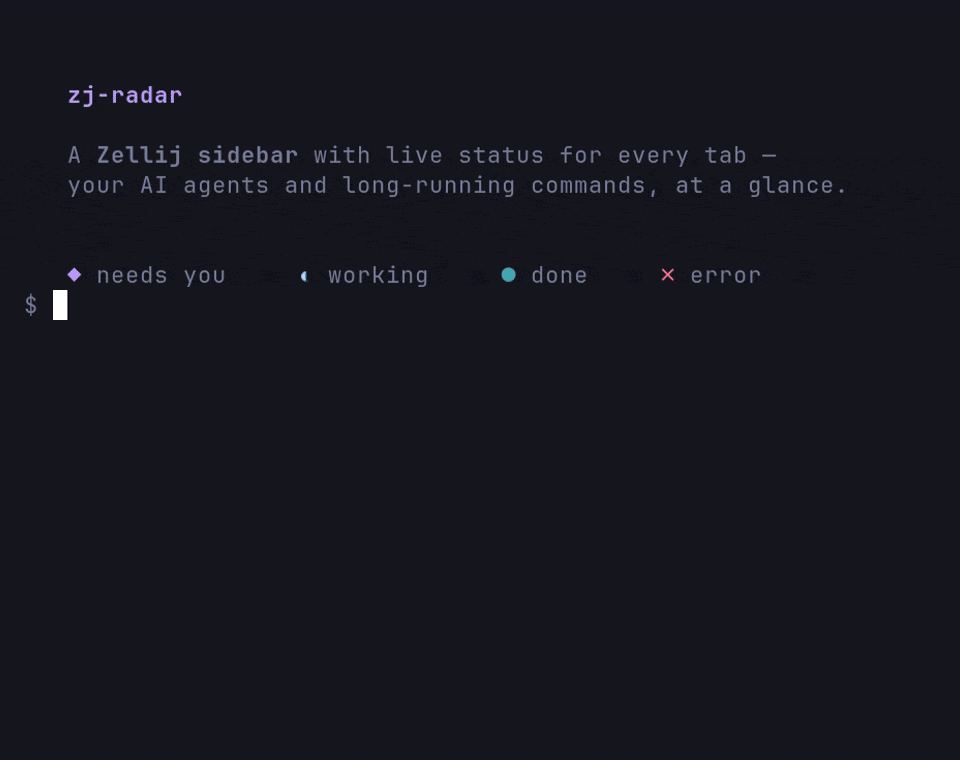

# zj-radar

A [Zellij](https://zellij.dev) sidebar that shows what every AI agent in your
session is doing: working, waiting for you, done, or failed. Click a row to
jump to that tab.

<p align="center">
  <a href="https://github.com/marktoda/zj-radar/actions/workflows/ci.yml">
    
  </a>
  <a href="https://crates.io/crates/zj-radar">
    
  </a>
  <a href="https://github.com/marktoda/zj-radar/blob/main/LICENSE">
    
  </a>
  
  
  
  
  
  
</p>

<p align="center">
  <a href="#quick-start">Quick start</a> ·
  <a href="#what-you-get">What you get</a> ·
  <a href="#how-it-works">How it works</a> ·
  <a href="#configuration">Configuration</a> ·
  <a href="#how-is-this-different">How is this different?</a> ·
  <a href="#documentation">Docs</a>
</p>



`◆ needs you` · `⠋ working` · `● done` · `✗ error` · `○ idle`

Agents like Claude Code work for minutes, then block on a permission prompt or
finish quietly. With many tabs open you lose track of which one needs you.
zj-radar puts that in a pinned left column inside the Zellij session you
already run. It does not launch, wrap, or own your agents.

## Quick start

Requires Zellij 0.46.0 or newer (`zellij --version`).

```sh
# 1. Install the zj-radar CLI (prebuilt for Linux and Apple Silicon macOS;
#    Intel macOS builds from source — see docs/install.md)
curl --proto '=https' --tlsv1.2 -LsSf \
  https://github.com/marktoda/zj-radar/releases/latest/download/install.sh | sh

# 2. Install the sidebar: the wasm, a `radar` alias, the rail in your default
#    layout, and Zellij's permission grant. Three y/N prompts, one per step.
zj-radar setup zellij --download

# 3. Start (or restart) Zellij.
zellij
```

Your agents need no setup: any program that reports its status to Zellij
(OSC 7501) shows up, and Claude Code, Codex, Opencode, pi, and omp do
([supported agents and their limits](https://github.com/marktoda/zj-radar/blob/main/docs/producers.md#supported-agents)).
Upgrading from a release that installed agent adapters? Remove them first:
[upgrade notes](https://github.com/marktoda/zj-radar/blob/main/docs/install.md#upgrading-from-a-release-with-agent-adapters).

Want to look before you commit? `zj-radar run` starts a throwaway session with
the rail wired in and leaves your config alone. Later, `zj-radar update` moves
the CLI and the sidebar to the latest release together. Source builds, Nix,
manual setup, and the full removal list are in
[`docs/install.md`](https://github.com/marktoda/zj-radar/blob/main/docs/install.md).

## What you get

- Per-tab and per-pane status for Claude Code, Codex, Opencode, pi, and
  omp, plus any program that reports to Zellij over OSC 7501.
- Jump to the tab that needs you: click its row, or bind `attention-next`
  ([keybinds](https://github.com/marktoda/zj-radar/blob/main/docs/configuration.md#binding-keys-to-commands)).
- Your Zellij stays yours: no new terminal, no tmux wrapper, no orchestrator.
- Shell commands show up too, from Zellij's own command tracking: a running
  command spins with an elapsed tag, a failed one shows its exit code.
- Background work an agent reports separately (a subagent, a backgrounded
  test run) gets its own lines under the agent's row.
- An `ssh` session into a host that runs Zellij shows that session's status
  as a row of its own, with no setup on either side.
- Desktop notifications when an agent finishes or needs you come from Zellij
  itself (its `attention` settings), not from the rail.
- Running several Zellij sessions? Each rail lists the others with live counts
  and click-to-switch (`session_tree true` expands each into its tabs and active panes).

What every glyph and line means:
[`docs/using.md`](https://github.com/marktoda/zj-radar/blob/main/docs/using.md).

## How it works

Agents report their state to Zellij with OSC 7501, Zellij's program status
protocol. Zellij turns that, and its own shell-command tracking, into
per-pane attention. The sidebar reads Zellij's attention events, rolls panes
up into tabs, and renders. It pins itself into your tab templates the same
way Zellij's own status bar does, so it appears in every tab and survives
layout swaps.

The plugin is push-driven. It never polls panes and makes no blocking host
calls on any per-event path. The two exceptions are both for tab naming: one
cwd lookup when a pane is created, and one background
`git remote get-url origin` per directory. Polling is what melted the predecessor plugin: see
[`docs/smart-tabs-postmortem.md`](https://github.com/marktoda/zj-radar/blob/main/docs/smart-tabs-postmortem.md).

## Configuration

Options go on the `radar` alias in `~/.config/zellij/config.kdl`. These are the
defaults; set a key only to change it:

```kdl
plugins {
    radar location="file:~/.config/zellij/plugins/zj_radar.wasm" {
        density "cards"         // cards · comfortable · compact
        naming "managed"        // off · managed · force
        spinner_fps 4              // working-spinner frames/s (1 = once a second)
        task_lines "lines"         // background tasks: lines · count · off
        ledger true                // recent completions under ─ earlier ─
        session_tree false         // expand other sessions into tabs + panes
        show_mode false            // Zellij mode on the footer (status bar optional)
    }
}
```

Change options live without editing anything:

```sh
zellij pipe --name zj_radar.config.v1 -- '{"density":"compact","header":false}'
```

The full option table, runtime pipes, and keybinds are in
[`docs/configuration.md`](https://github.com/marktoda/zj-radar/blob/main/docs/configuration.md).

## How is this different?

| Tool | Best for | How `zj-radar` differs |
|---|---|---|
| [Claude Squad](https://github.com/smtg-ai/claude-squad) | Running multiple agents in isolated git worktrees from one TUI. | `zj-radar` does not launch or own agents; it shows status inside the Zellij session you already use. |
| [cmux](https://github.com/manaflow-ai/cmux) | A macOS terminal with vertical tabs, notifications, browser panes, and agent-aware UI. | `zj-radar` is a Zellij plugin, not a new terminal app. |
| [zjstatus](https://github.com/dj95/zjstatus) | Replacing / customizing the Zellij status bar. | `zj-radar` is an agent-status rail; it leaves your existing status bar alone. |
| Plain Zellij tabs | Manual multiplexing. | `zj-radar` adds agent state, elapsed time, messages, and jump-to-attention behavior. |

## Documentation

| Doc | What's in it |
|-----|--------------|
| [`docs/install.md`](https://github.com/marktoda/zj-radar/blob/main/docs/install.md) | Install paths (CLI, source, Nix, manual), layouts, permissions, `--check`, upgrading from agent adapters, full removal. |
| [`docs/using.md`](https://github.com/marktoda/zj-radar/blob/main/docs/using.md) | Reading the rail: glyphs, tree rows, tags, footer, mouse gestures, cross-session badge. |
| [`docs/configuration.md`](https://github.com/marktoda/zj-radar/blob/main/docs/configuration.md) | Option table, the `config.v1` and `cmd.v1` pipes, keybinds. |
| [`docs/producers.md`](https://github.com/marktoda/zj-radar/blob/main/docs/producers.md) | Which agents report status and their limits, and how to report from your own program. |
| [`docs/troubleshooting.md`](https://github.com/marktoda/zj-radar/blob/main/docs/troubleshooting.md) | Symptom → fix: blank rail, missing agent status, layout quirks, terminal rendering. |
| [`docs/activity-model.md`](https://github.com/marktoda/zj-radar/blob/main/docs/activity-model.md) | What each status and kind means and how it renders. |
| [`docs/design.md`](https://github.com/marktoda/zj-radar/blob/main/docs/design.md) | Architecture and mechanisms. |
| [`docs/rail-reference.md`](https://github.com/marktoda/zj-radar/blob/main/docs/rail-reference.md) | The executable render spec; the plugin's reference tests parse it. |
| [`CONTEXT.md`](https://github.com/marktoda/zj-radar/blob/main/CONTEXT.md) | Domain glossary for contributors. |
| [`CONTRIBUTING.md`](https://github.com/marktoda/zj-radar/blob/main/CONTRIBUTING.md) | Build, test layers, lint, dev loop, PR rules. |

The changelog is the [GitHub Releases page](https://github.com/marktoda/zj-radar/releases).

## Development

```sh
cargo test    # host tests, no wasm needed
just dev      # build and launch a sandboxed dev session
```

[`CONTRIBUTING.md`](https://github.com/marktoda/zj-radar/blob/main/CONTRIBUTING.md)
covers the test layers, formatting, and PR expectations. The hero
GIF is reproducible from
[`demo/`](https://github.com/marktoda/zj-radar/tree/main/demo).

## License

MIT — see [`LICENSE`](https://github.com/marktoda/zj-radar/blob/main/LICENSE).
